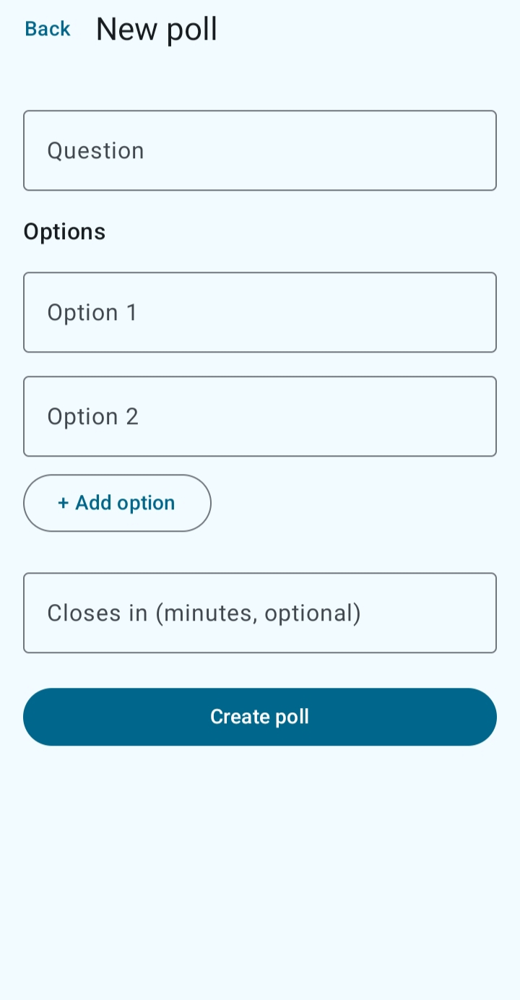

# QuickPoll – Campus Opinion & Voting App

A full-stack campus polling app: students register, create polls, vote once per poll, and see live percentage results. Built with a **Spring Boot + PostgreSQL** backend and a native **Android (Kotlin + Jetpack Compose)** client.

## Screenshots

      

## Features

- JWT authentication (register / login) with BCrypt password hashing
- Create polls with 2–6 options and an optional expiry time
- Search and browse polls (paginated)
- One vote per user per poll, enforced at both the application and database level
- Results with vote counts and percentages; closed polls reject new votes

## Tech Stack

| Layer | Technology |
|---|---|
| Android | Kotlin, Jetpack Compose, Material 3, MVVM + Repository, StateFlow, Coroutines, Navigation Compose, Retrofit/OkHttp |
| Backend | Java 17, Spring Boot, Spring Security (JWT), Spring Data JPA / Hibernate |
| Database | PostgreSQL |
| Deployment | Render (backend + database) |

## Architecture

```
Android app (Compose UI → ViewModel → Repository → Retrofit)
        │  HTTPS + JWT
        ▼
Spring Boot REST API (Controller → Service → Repository)
        │
        ▼
PostgreSQL
```

## REST API

| Method | Endpoint | Auth | Description |
|---|---|---|---|
| POST | `/api/auth/register` | No | Create account, returns JWT |
| POST | `/api/auth/login` | No | Login, returns JWT |
| GET | `/api/polls?page=&size=&search=` | Yes | List / search polls |
| GET | `/api/polls/{id}` | Yes | Poll with options and results |
| POST | `/api/polls` | Yes | Create a poll |
| POST | `/api/polls/{id}/vote` | Yes | Cast a vote (`{"optionId": 1}`) |

## Concurrency & Data Integrity

Voting is the contended path, so it is protected in layers:

1. **Pessimistic row lock**: `SELECT ... FOR UPDATE` on the poll serializes concurrent votes on the same poll.
2. **Atomic counter update**: `UPDATE poll_options SET vote_count = vote_count + 1`, with no read-modify-write in Java.
3. **Composite unique index** on `votes(poll_id, user_id)` guarantees one vote per user per poll, even if application checks are bypassed.
4. An index on `poll_options(poll_id)` for fast results loading.

### Measured results

Measured on a local machine with PostgreSQL, using the JUnit concurrency test in `src/test`:

| Test | Result |
|---|---|
| 500 votes from 50 concurrent threads on one poll | 0 lost, 0 failed, per-option counts exact |
| 20 simultaneous votes from the same user | exactly 1 accepted |
| Throughput on a single contended poll (worst case) | ~160 votes/sec |
| Duplicate-vote lookup (`EXPLAIN ANALYZE`, 100K votes) | index scan, ~0.09 ms |

Run the concurrency test yourself:

```bash
./mvnw test -Dtest=VoteConcurrencyTest
```

## Getting Started

### Prerequisites
- JDK 17+
- PostgreSQL (create a database, e.g. `quickpolldb`)
- Android Studio (for the app)

Set the configuration through environment variables:

| Variable | Example |
|---|---|
| `SPRING_DATASOURCE_URL` | `jdbc:postgresql://localhost:5432/quickpolldb` |
| `SPRING_DATASOURCE_USERNAME` | `postgres` |
| `SPRING_DATASOURCE_PASSWORD` | your DB password |
| `APP_JWT_SECRET` | a random string of at least 32 characters |

### Android app

1. Open the `Android Frontend` folder in Android Studio and let Gradle sync.
2. In `data/RetrofitClient.kt`, set `BASE_URL`:
   - Emulator + local backend: `http://10.0.2.2:8080/`
   - Deployed backend: your Render URL (must end with `/`)
3. Run on an emulator or device.

> **Note:** On Render's free tier the backend sleeps when idle, so the first request after a while can take up to a minute.

## Project Structure

```
QuickPoll/
├── src/main/java/com/quickpoll/     # Spring Boot backend (controller, service, repository, entity, security)
├── src/test/java/com/quickpoll/     # Concurrency tests
├── Android Frontend/                # Kotlin + Jetpack Compose app
└── pics/                            # App screenshots
```
